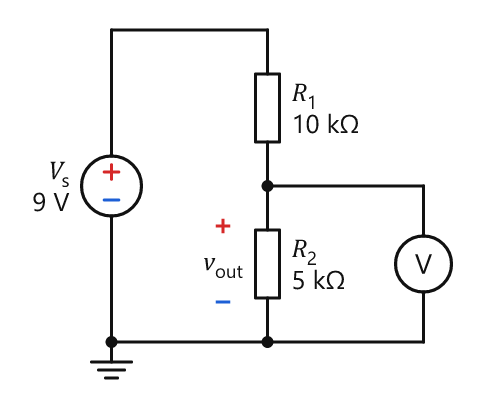
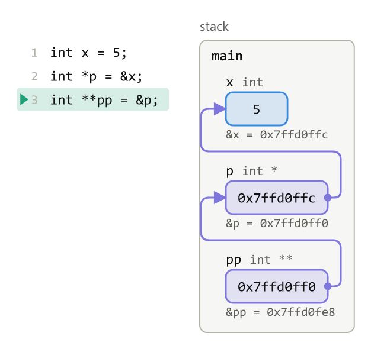
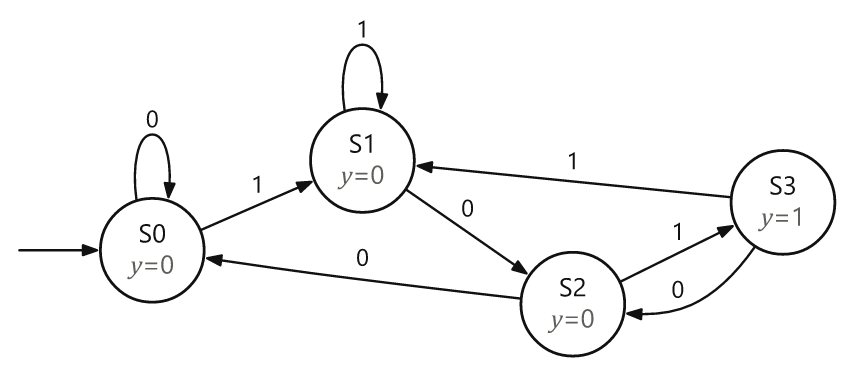
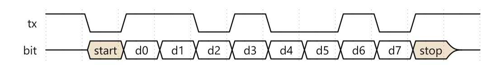

# techviz

Renders technical diagrams from short JSON specs: circuit schematics, memory
and pointer diagrams, struct layouts, timing diagrams, state machines,
plots, and free-body diagrams. You describe what the diagram shows; techviz does the layout and
returns an SVG, a PNG, and a one-line summary of computed facts (nets,
pointer targets, offsets, force sums) that can be checked against what you meant.

I built it so Claude can draw clean diagrams while helping with engineering
coursework. It runs as a command-line tool, a Node library, and a browser
bundle with sliders and step-through controls. It was written with Claude
Code.

| | |
| --- | --- |
|  |  |
|  |  |

## Kinds

| Kind | Draws |
| --- | --- |
| `circuit` | Schematics in IEC symbols, with nets checked |
| `memory` | Stack, heap, globals, pointers, arrays, and code traces |
| `layout` | Struct padding and offsets, endianness, address maps |
| `wave` | Timing diagrams (WaveJSON), register bitfields, pipeline charts |
| `fsm` | Moore and Mealy state machines, or any directed graph |
| `plot` | Functions, parametric curves, data, and slope fields |
| `fbd` | Free-body diagrams: forces, inclines, ropes and pulleys, supports and beam loads, fields |

Every spec can also have `params` (named values, drawn as sliders in the
browser) and `steps` (stages shown one at a time). The field reference for
each kind is in [`docs/catalog/`](docs/catalog/), and
[`examples/`](examples/) has 3 to 6 specs per kind.

## Example

The voltage divider above is this spec:

```json
{"v": 1, "kind": "circuit",
 "parts": [
  {"id": "V1", "t": "V", "at": [0, 6], "dir": "up", "len": 6, "label": "V_{s}", "value": "9 V"},
  {"t": "wire", "dir": "right", "len": 3},
  {"id": "R1", "t": "R", "dir": "down", "label": "R_{1}", "value": "10\\,k\\Omega"},
  {"id": "R2", "t": "R", "label": "R_{2}", "value": "5\\,k\\Omega"},
  {"t": "wire", "to": "V1.start"},
  {"t": "ground", "from": "V1.start"},
  {"t": "wire", "from": "R2.start", "dir": "right", "len": 3},
  {"id": "VM", "t": "voltmeter", "dir": "down"},
  {"t": "wire", "to": "R2.end"}
 ],
 "voltages": [{"across": "R2", "label": "v_{out}"}]
}
```

## Usage

```bash
npm install
node src/cli.js render examples/circuit-divider.json --out out --theme paper
node src/cli.js check examples/circuit-divider.json
```

`render` writes an SVG and a PNG (`--theme paper|dark|host`, `--scale`,
`--step N`) and prints one JSON line with the file paths, size, diagnostics,
and summary. `check` validates a spec without drawing it.

As a library:

```js
import { renderAsync } from './src/index.js'
const { svg, summary, diagnostics } = await renderAsync(spec, { theme: 'paper' })
```

In a web page, put each spec in a `<script type="application/json"
data-techviz>` tag and load the bundle. It draws every spec on the page and
adds the slider and step controls:

```html
<script type="application/json" data-techviz>{"v":1,"kind":"plot", ...}</script>
<script src="https://cdn.jsdelivr.net/gh/dante32683/techviz@v0.1.0/dist/techviz.js"></script>
```

## Development

```bash
npm test        # renders every example in all three themes and checks computed facts
npm run build   # rebuilds dist/techviz.js
```

[`docs/kinds.md`](docs/kinds.md) explains how to add a kind. `probe/` is a
small script that checks what a host page's sandbox allows.

MIT licensed.
